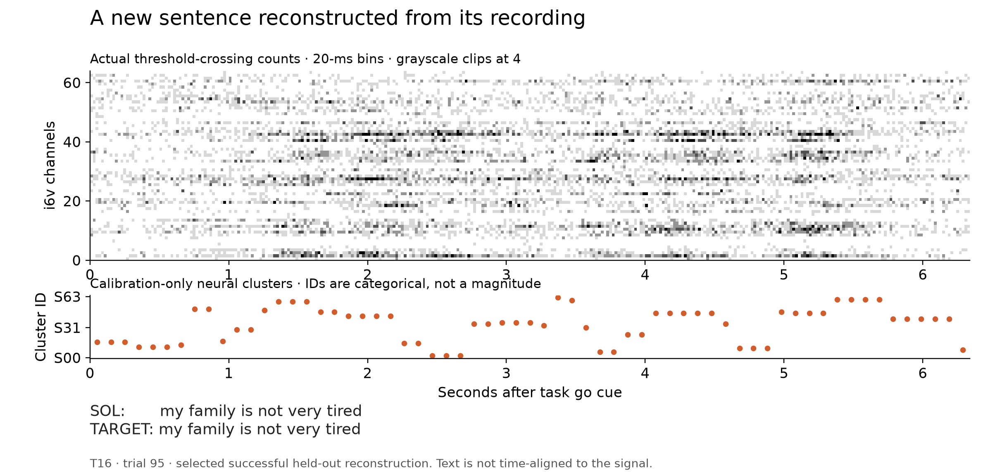
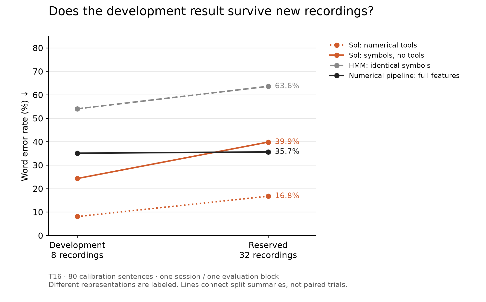

# I used GPT-6.1 Sol to turn brain activity into sentences

“My family is not very tired.”

GPT-6.1 Sol reconstructed that sentence from a neural recording. The participant had been cued to attempt those words, but the whole sentence was absent from the model's calibration examples.

I gave Sol 80 labelled recordings, then asked it to reconstruct the sentences in 32 later recordings without their transcripts. It recovered **18 sentences exactly**, with **16.8% word error rate**. A conventional decoder using the same calibration data and neural features reached **35.7% word error**. An independent Sol call recovered 15 sentences exactly at 21.0% word error.

Sol was not fine-tuned. It had examples, a Python environment, and generic signal-processing code. It used those to construct a decoding procedure during inference. I then tested how much of the result came from that numerical procedure, how much Sol's final interpretation added, and whether other approaches worked better.

*One successful held-out reconstruction. The upper panel shows actual threshold-crossing counts; the lower panel shows clusters learned from calibration activity without word labels. No word boundaries were supplied. The decoded text describes the whole recording and is not aligned to individual moments in the signal.*

[Watch the 32-second film](video_v2.mp4). It shows four selected held-out reconstructions; the results below cover the full evaluation cohorts.

## Why I moved beyond word classification

I started with seven-choice word identification. Given labelled examples, Sol recognized 52 of 98 later neural recordings, compared with 14 of 98 when query neural input was omitted. Reassigning the recordings to different query IDs reduced its score against the original labels to 16 of 98. Its predictions contained information about the recordings.

The effect repeated across independent calls and in a second participant with participant-specific calibration. But when I matched the features, calibration examples and test recordings, conventional classifiers remained competitive. In the full-calibration T12 comparison, Sol averaged 56.1% accuracy; regularized LDA with a simple unlabelled mean-alignment step reached 59.2%. Correcting recording shifts closed or reversed much of the apparent advantage over static classifiers.

I had evidence that Sol could learn neural-label associations, but no consistent reason to prefer it for that classification task. I changed the question: could it use examples of component words to reconstruct combinations it had not been shown?

A small test with *up* and *right* showed that it could reconstruct new three-word sequences. The vocabulary was still only two words. I then moved to sentence recordings with a larger vocabulary and allowed numerical tools, while checking how much those tools could accomplish without Sol. The sentence results below came from that progression.

[Watch the early word-order experiment · 12 seconds](video_v1_short.mp4)

## What the model was given

The recordings come from the public [Kunz et al. dataset](https://pmc.ncbi.nlm.nih.gov/articles/PMC12360486/). Electrodes implanted in speech-related motor cortex recorded a participant who saw a sentence, waited for a go cue, and attempted to say it. These were open-loop trials: an existing decoder's text was not being displayed to the participant.

The input contains threshold-crossing counts and spike power: how often a channel crosses a voltage threshold, and the energy in its high-frequency electrical activity. No microphone audio or original decoder outputs were used.

For participant T16, the 80 calibration sentences came from two earlier recording blocks. Eight recordings in the next block served as development data for choosing the method and anatomical region. The other 32 were reserved before predictions.

Calibration covered all 49 word types observed in this session. Sol had to recognize them in new recordings and reconstruct their order, without being given word boundaries or the number of words in a query. For example, calibration contains “my faith is my success”; a later recording contains “my hope is my success.” Copying a whole calibration sentence cannot produce that answer.

Two evaluation targets also appear as shorter, contiguous spans inside calibration transcripts. Excluding them leaves 30 strictly novel targets. On those, the first Sol call recovered 16 exactly at 17.5% word error.

This experiment tests new combinations of familiar words. Generating words that never appeared in calibration is a harder problem, which I tested separately.

## How Sol built the decoder

Sol received the recordings as numerical arrays and worked on them in Python. The supplied helpers supported smoothing, principal component analysis (PCA), similarity comparisons and temporal alignment. They contained no learned neural-to-word mapping.

Sol used these tools to compare calibration recordings with overlapping transcripts. If several sentences contain the same word, their neural trajectories provide clues about where its activity might recur. The model used those comparisons to estimate word boundaries and build references for individual words.

In the first T16 confirmation call, it constructed **334 word-labelled interval references covering 49 words**. These were pieces of calibration recordings with model-estimated timestamps. They were not observed word annotations.

Numerical code compared query intervals with those references and assembled provisional word sequences. Sol then inspected ambiguous intervals and overlapping phrase evidence before writing its final answers.

Its parameters stayed fixed, but it fitted a task-specific procedure to the examples during the call.

The saved inputs and actions are available for inspection. An audit reconstructed all 112 calibration and query arrays exactly, verified that PCA used calibration data only, and checked that the word references came from calibration. No target-file or network reads were observed in the successful call. These checks cover the input pipeline and recorded actions; they do not reveal how Sol represents the associations internally or what was in its pretraining data.

## What Sol added

Word error rate (WER) counts substitutions, deletions and insertions, divided by the number of target words. Exact-sentence accuracy requires the entire normalized word sequence to match. Capitalization and punctuation are not scored. The 32 reserved recordings contain 143 target words.

| Method on the same 32 recordings | WER | Exact sentences |
|---|---:|---:|
| Fixed numerical decoder | 35.7% | 4 |
| Sol with numerical tools, first call | **16.8%** | **18** |
| Sol with numerical tools, independent repeat | 21.0% | 15 |

The numerical baseline uses interval retrieval, alignment, estimated word timing and calibration text statistics to assemble new sentences. Its settings were selected using calibration blocks alone. Its reserved-cohort predictions were saved and hashed before target access. A version transferring settings from T12 scored 38.5% WER and six exact sentences.

Against the T16-calibrated baseline, the first Sol call made fewer word errors on 20 recordings and more on none. The repeat made fewer errors on 19 and more on three.

The paired WER reductions were 18.9 and 14.7 percentage points. A bootstrap resampling recordings within this cohort gives descriptive 95% intervals of 13.0–25.3 and 8.0–20.8 points. Those intervals describe one recording block. They do not capture uncertainty across sessions or people, and two model calls do not turn 32 recordings into 64 independent samples.

I also scored the three automatic word sequences saved by Sol's own code during the first call. They reached **30.1–35.0% WER**, compared with 16.8% after its final interpretation. Even the lowest-error numerical output contained 19 more word edits than the final answer.

These procedures already include Sol's choices of reference intervals, timing and computation. They are not independent baselines. The comparison measures an additional improvement after those choices had already been made.

Could language correction alone recover it? A separate text-only Sol call received the last numerical word sequence and the 80 calibration transcripts, with no query neural signal, similarity scores or final answers. It recovered 15 exact sentences at **30.8% WER**. It fixed several sentences completely but made larger errors in others. It did not reproduce the full call's lower overall error.

That test was designed after the 32 recordings had been scored. It also gave the model less information and used less computation. It helps distinguish the final-stage contributions, but cannot isolate a mechanism inside Sol.

*The eight-recording development result was 8.1% WER. On the reserved cohort, the first call reached 16.8% and the repeat 21.0%. The plot shows the first call; input representations are labelled.*

## Giving Sol a neural alphabet

I also tested whether Sol could work directly with a sequence of neural states, without running its own numerical tools.

The preprocessing smoothed the recordings, fitted PCA and 64 clusters using calibration neural frames alone, and assigned arbitrary, consistently permuted IDs to those clusters. A symbol such as `S17:3` means three approximately 100-ms frames in state S17. It is a cluster identifier, not a decoded phoneme or letter. No transcripts were used to learn the states.

Sol received calibration sentences paired with their symbol strings. It then reconstructed query sentences **without tools or numerical retrieval**. It recovered three of eight development sentences exactly. With the preprocessing and instructions fixed, it recovered **9 of 32 reserved sentences at 39.9% WER**.

A conventional hidden Markov model (HMM), trained to compose word states from exactly the same symbols, reached 63.6% WER and two exact sentences. It used transcript-constrained alignment and calibration-selected settings.

Sol did better than that matched-symbol comparator. The numerical decoder using the full neural features still had lower WER than symbolic Sol. The result shows that Sol can infer word-related structure from these unfamiliar strings; it does not show that the clusters themselves are linguistic units or that this interface beats every conventional decoder.

## Combining the approaches

The symbolic and full-feature numerical methods make different errors. Symbolic Sol uniquely gets seven sentences exactly; the numerical method uniquely gets two. Checking against ground truth, a perfect sentence selector could recover eleven exact sentences. Allowing it to combine words from both proposals gives an oracle WER of 21.0%.

That calculation uses the answers to make the choices. It measures what could be recovered from the existing proposals, not what a decoder actually achieved.

I tested an actual fusion call. Sol received both unverified proposals, the calibration symbol strings and the query strings, without targets or accuracy feedback. It produced **eight exact sentences at 38.5% WER**. That is worse WER than the stronger numerical proposal and fewer exact sentences than symbolic Sol.

This was a development test on previously scored recordings. It also explicitly supplied a conventional decoder's outputs, so it is a fusion comparison rather than another Sol-only direct-decoding experiment.

The strongest tool-assisted Sol call already gets every exact symbolic success right. Between those two Sol outputs, a perfect sentence selector could save only one additional word edit. A word-level oracle could save two, with no additional exact sentences. I did not pursue a fusion sweep.

For now, the lowest error comes from the call that inspected neural intervals and calibration comparisons. Combining the existing proposals and symbolic evidence did not match it. Since the calls also differed in information access and computation, this suggests a useful next experiment rather than proving why the stronger method worked.

## Shuffling the recordings

To check whether the predictions followed the neural input, I reassigned recordings to different query IDs within duration groups and ran a fresh tool-assisted call. The same predictions can then be scored against the original assigned targets and against the sentences belonging to the actual recordings:

| Scoring the shuffled-call predictions | WER | Exact sentences |
|---|---:|---:|
| Against the original assigned targets | 98.6% | 0/32 |
| Against the actual recording donors | 20.3% | 16/32 |

The predictions followed the reassigned recordings. A separate symbolic shuffle produced 96.5% nominal WER and 44.1% donor WER. Together, these controls show that IDs, broad duration cues and sentence priors alone do not explain the results.

I also tested another participant, T12, using 120 participant-specific calibration sentences. Two independent calls on sixteen later recordings reached 40.8% and 35.2% WER, versus the numerical workflow's 47.9%. Both exactly reconstructed “tell my family i do not feel thirsty.” A recording shuffle again tracked donors. These gains were smaller, and their descriptive paired intervals included zero.

For T16, the repeat used an identical prompt and input payload in a fresh directory, without the first call's word references or predictions. Twenty of 32 complete prediction strings agreed. All fifteen repeat-exact sentences were also correct in the first call.

## What failed

Presenting the neural data as heatmaps worked poorly: zero exact sentences out of eight, at 64.9% WER. That compressed visualization was less effective than the symbolic interface. Several representation choices changed together, so this does not isolate tokenization as the cause or rule out other visual approaches.

The more ambitious failure was decoding unfamiliar words. In a separate [Willett 2023 recording](https://pmc.ncbi.nlm.nih.gov/articles/PMC10468393/), Sol received 168 examples of 42 words, followed by sixteen query recordings from eight word types absent from calibration. It received no query-word menu. Every target phoneme appeared in calibration words.

Sol built phoneme/articulatory forward models, predicted neural trajectories from candidate pronunciations, and searched a general dictionary. It recovered **zero of sixteen query words**.

A conventional known-word diagnostic could still recognize 50 of 84 later recordings from that source, against 1/42 chance. The recordings retained word information. The attempted transfer from known words to new combinations of phonemes did not work.

Most of the forward models used simple assumed phoneme timings. Context-dependent articulation could violate those assumptions. There were also only four labelled examples per calibration word, recorded in earlier blocks. The experiment does not separate timing errors, limited data, noise and drift. Exploratory calibration cross-validation showed some phonetic structure, but was reused for model selection and cannot substitute for success on the queries.

The sentence results have limits too. Participants saw the target sentence before attempting speech. The signal could reflect the remembered cue, preparation, production, or a mixture of these; this experiment does not separate them.

Recordings also came with task start and end times. Mean subtraction used the unlabelled data across a whole block, and inference processed batches. I have not tested whether the same procedure works one trial at a time or on a different day. Both participants received their own labelled calibration data.

Some errors changed the message. The first T16 call returned “i hope family” for “i have no family,” and confused *nurse* with *music*.

## What I would test next

Specialized systems already decode sentences from neural activity, as [Willett et al.](https://pmc.ncbi.nlm.nih.gov/articles/PMC10468393/) and [Kunz et al.](https://pmc.ncbi.nlm.nih.gov/articles/PMC12360486/) demonstrate. Related work includes [meta-optimized in-context visual decoding](https://arxiv.org/abs/2604.08537) and [trained brain–language interfaces](https://arxiv.org/abs/2509.23941). I am not claiming the first neural sentence decoder or an exhaustive novelty search.

Here, a general-purpose model constructed and used a participant-specific procedure during inference. It beat the automatic assembly procedures tested on T16, and a separate experiment decoded sentences from neural-state strings without tool execution. Whether those gains survive stronger custom decoders, new sessions and unfamiliar words remains open.

There is also a large speed gap. The first tool-assisted call took about 23 minutes for 32 recordings; the repeat took about 18. The numerical workflow generated its evidence and predictions in about 36 seconds. Sol's cumulative input usage across tool turns was mostly cached, but still substantial. This was offline reconstruction, not real-time communication.

I would next test whether Sol can choose the right neural comparison when it is uncertain. If *nurse* and *music* are competing hypotheses, which calibration examples and query interval would distinguish them? Can the model identify that comparison, inspect it, and recognize when the evidence is still insufficient?

That experiment should use new recording sessions and words absent from calibration, with an automated procedure given the same tools and a comparable computation budget. It would test whether choosing what to measure adds a repeatable advantage beyond the current set of recordings.

---

**Code and evidence.** All experimental model calls used authenticated Codex with `gpt-6.1-sol` and high reasoning effort. The [reproduction guide](../research/phase3-sentence-reconstruction/REPRODUCE.md) describes the saved prompts, inputs, numerical code, predictions and audits. Detailed results include [the primary comparison](../research/phase3-sentence-reconstruction/evaluation/t16_confirmation_comparison.json), [repeat and controls](../research/phase3-sentence-reconstruction/evaluation/t16_replication_and_controls.json), [within-call attribution](../research/phase3-sentence-reconstruction/evaluation/t16_within_call_algorithm_contribution.json), and [symbolic decoding and its shuffle control](../research/phase3-sentence-reconstruction/evaluation/neural_alphabet_confirmation_comparison.json). Complementarity bounds and the failed fusion result are preserved alongside them.
