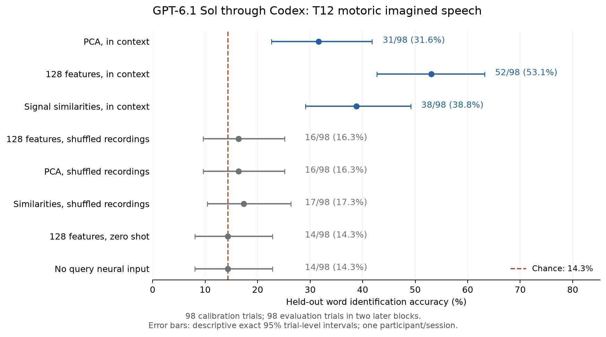

# GPT-6.1 Sol neural decoding pilot

18 November 2026. Model: `gpt-6.1-sol`, exclusively through authenticated Codex, high reasoning effort.

This pilot found calibration-dependent information about cued words in held-out neural recordings. The strongest call identified **52/98 words (53.1%)** from seven choices, versus **14.3% chance** and **14.3% without query neural input**. Its matched shuffled-recording score was **16/98 (16.3%)**. This supports a narrow capability: in-context identification of previously calibrated words from intracortical features. Zero-shot identification was not demonstrated. Speech-specific interpretation remains unresolved.

## What we tested

We used T12's `t12.2023.08.15_imagined1stMotor_raw.mat` from the isolated verbal behaviors task. The original study's controlled word task offers repeated, unambiguous cued labels and previously demonstrated neural word information. This is a suitable starting point before sentence reconstruction. [Article](https://pmc.ncbi.nlm.nih.gov/articles/PMC12360486/), [task documentation](https://huggingface.co/datasets/raei/Kunz-2025-InnerSpeechMotorCortexImplicationsSpeechNeuroprostheses/blob/main/isolatedVerbalBehaviors/isolatedVerbalBehaviors_readme.txt).

- Words: ban, choice, day, feel, kite, though, were. Rest trials excluded.
- Calibration: blocks 8 and 9, 98 recordings, 14 per word. Evaluation: later blocks 17 and 25, another 98 recordings, 14 per word. No recording/window reuse or exact duplicates across the split.
- Input: 64 i6v channels; mean threshold crossings and mean log1p spike power, fixed 200–1200 ms after go. Standardization used calibration inputs only.
- Representations: all 128 standardized features; 12 calibration-only, unwhitened PCA coordinates; and a follow-up table of distances to individual calibration recordings. The PCA retained 45.3% of calibration variance.
- Each call received individual calibration examples and randomized query IDs/order. All 98 query inputs were supplied in one batch, so unsupervised use of batch structure was possible; this was not streaming evaluation. Zero-shot omitted labeled examples; the no-input control omitted query signals. Shuffled controls reassigned recordings within each evaluation block, preserving the same query IDs and target labels.

No fine-tuning, gradients, pretrained neural encoder, or external fitted supervised decoder was used. The distance representation computed signal-to-signal distances without labels; it did not produce word scores or votes. Sol made every word decision. All prediction calls were fresh ephemeral Codex contexts; event logs show no tool use or evaluator-file access. No test feedback entered a prediction call.

## What happened

| Condition | Correct | Accuracy | 95% interval |
|---|---:|---:|---:|
| 128 features + calibration | 52/98 | 53.1% | 42.7–63.2% |
| 128 features, shuffled recordings | 16/98 | 16.3% | 9.6–25.2% |
| 12 PCA coordinates + calibration | 31/98 | 31.6% | 22.6–41.8% |
| PCA, shuffled recordings | 16/98 | 16.3% | 9.6–25.2% |
| Signal similarities + calibration | 38/98 | 38.8% | 29.1–49.2% |
| Similarities, shuffled recordings | 17/98 | 17.3% | 10.4–26.3% |
| 128 features, zero-shot | 14/98 | 14.3% | 8.0–22.8% |
| No query neural input | 14/98 | 14.3% | 8.0–22.8% |

Intervals are exact, descriptive 95% trial-level intervals. Each row is one model call on the same 98 recordings; model-call variability is not estimated. Trials share two recording blocks, so these intervals cannot establish precision across people or days.

The raw-feature result was 29/49 (59.2%) in block 17 and 23/49 (46.9%) in block 25. Its advantage over PCA was 21.4 percentage points in this run. Every word had correct raw-feature predictions; “were” improved from 0/14 with PCA to 10/14 with all features.

For each of the three correct-recording, calibrated representations, none of 20,000 within-block label permutations reached the observed accuracy. The plus-one Monte Carlo p-value is 0.000050; a conservative correction for three representations gives 0.000150. These are conditional checks of recording/label association, not estimates of population generalization. Paired comparisons and confusion matrices are in `evaluation/metrics.json`.

The shuffled predictions provide a second check: PCA predictions matched the supplied recording's actual donor word on 32/98 trials, despite only 16/98 matches to the nominal target; the similarity condition gave 36/98 donor matches versus 17/98 target matches. For the raw-feature control, 56/98 predictions matched the donor word versus 16/98 nominal targets. The raw correct-recording versus shuffled comparison gave 44 real-only correct and 8 shuffled-only correct cases (descriptive one-sided exact McNemar p = 0.000000202).

The similarity probe and the raw-feature matched control were added adaptively; the log records when and why. All attempted prediction conditions are reported. A capacity error delayed the PCA shuffled call; it completed using the requested model without substitution.

## What we learned

The correct recording adds usable word information beyond the supplied language choices and calibration label frequencies. This is evidence for direct, calibration-assisted neural word identification within the tested protocol. It does not show a pre-existing semantic interpretation of arbitrary electrodes: both zero-shot and no-input calls made an explicit fixed guess and scored at chance.

Representation matters. PCA failure would have understated the capability: it discarded 54.7% of input variance and produced predictions concentrated on three words. Useful discriminative information may lie outside those components. Giving explicit signal similarities improved on PCA but remained below all 128 features, so arithmetic difficulty alone does not explain the results. Sol's claimed pattern-matching mechanisms are self-reports, not verified explanations.

The later blocks have substantial offset drift: their mean feature vectors shift by 0.70 and 1.05 calibration standard deviations RMS, versus 0.14 in each calibration block. Accuracy falls in the later block for all three representations. Drift is a plausible explanation, but this pilot does not establish it causally.

The physiological limit is important: text disappears at go in this task, but the recording can still contain cue memory, preparation, or other word-linked activity. The controls exclude the tested missing-signal/recording-link alternatives; they do not uniquely isolate inner-speech production. Ground truth is the instructed word, not independent verification of a private subjective utterance. One participant, one session, eight calls, and no repeat-call estimate limit the strength of the claim.

## Highest-value next experiments

1. **Correct drift without learning word labels.** Test same-trial pre-go subtraction or a prespecified unlabeled baseline. Hypothesis: offset shifts explain much of the later-block loss. Existing recordings support exploratory analysis; confirm any benefit on an untouched session or participant. Recovery would identify a route to more stable decoding. Freeze preprocessing before opening the next evaluation labels.
2. **Separate cue recognition from inner-speech execution.** Compare delay activity with go-minus-delay activity and matched cue-only behavior. Hypothesis: production adds information beyond remembered text. Existing delay epochs support an initial test; a clean causal conclusion may need better-matched task conditions. This determines what a public demonstration could honestly claim.
3. **Replicate with fresh label mappings and model calls.** Randomly remap calibration labels to arbitrary tokens and test whether predictions follow the mapping on untouched recordings, then repeat the fixed protocol. Hypothesis: the effect is reproducible in-context association rather than a fortunate call or familiar word mapping. This is feasible without training a specialized decoder and should precede sentence-level expansion.

## Is anything demoable?

A recorded-data demonstration is feasible: choose held-out trials at random, hide their labels, show the neural features and calibration, reveal Sol's stored prediction, then reveal ground truth and the control results. Include every evaluation trial, errors, and all seven candidate words. The honest claim is seven-choice, participant-calibrated word identification from recorded intracortical activity. The strongest 98-trial call took 673 seconds; real-time latency was not tested. There is no basis yet for an unrestricted thought-to-text demonstration.

## Reproducibility

`README.md` gives commands. `code/`, `config.json`, `requirements.txt`, exact prompts, final responses, invocation/event logs, evaluator outputs, and the concise research log are included. The selected source file is downloadable through the code and verified by SHA-256; saved evaluation features and responses permit rescoring without a new model call. See `sources.md` for source provenance. The pilot stops at this milestone; the proposed next experiments have not been run.
